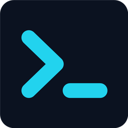

<div align="center">



# DevGo

**A project launcher for developers, the same on Windows, Mac and Linux.**<br>
Every project you have, one keystroke to where you work on it.

[](https://github.com/joyahmed/devgo/releases/latest) [](#install) [](LICENSE)

### [⬇ Download DevGo](https://github.com/joyahmed/devgo/releases/latest)

Free · No tracking · Rust + Tauri 2 + React 19

</div>

<br>

## Why I built this

For a long time my "launcher" was a right-click. A few PowerShell scripts put *Open Ubuntu here* and *Open VS Code WSL here* on every folder, and a handful of shell shortcuts knew what to do inside a project. But a right-click needs you to find the folder first. The real question was always *which project, and where does it live*: on the local disk, in a WSL distro, on GitHub, on a server.

So in May 2026 I wrote the first DevGo in C# and WinForms ([devgo-winforms](https://github.com/joyahmed/devgo-winforms)): one window, every project, one keystroke. It only ran on Windows, and I also work on a Mac and on Ubuntu. Two weeks later I started this rewrite in Tauri and Rust, partly to learn Rust properly.

I also run the servers my apps live on, and that knowledge sat in a folder of shell scripts. Now the servers are a lane in DevGo too. It is not an editor, a terminal or a git client. It opens the door and gets out of the way. I use it every day.

## Highlights

- 🛣️ **Four lanes**: your local projects, your WSL distros, your GitHub repos and your servers, side by side.
- ⌨️ **One keystroke**: open a project in your editor, your terminal or your coding agent. <kbd>Ctrl</kbd>+<kbd>K</kbd> to search.
- 🔁 **Sessions that survive**: with tmux (or psmux on Windows) on, close the terminal, come back, and you are where you left off.
- 🐙 **GitHub**: every repo you own, through the `gh` you already use. Clone into a workspace, group repos, open a branch.
- 🖥️ **Servers**: every host in your ssh config. Enter opens a tmux session on the box. A box can list its own apps and actions.
- 🐧 **WSL that stays asleep**: DevGo never boots a stopped distro just to show you its projects.
- 🎨 **Five themes**, a transparency knob, text size from 85 to 150 percent.
- 🔒 **Private**: no telemetry, no updater, no tokens or passwords of its own.

<details>
<summary><b>Everything it does</b> (click to open)</summary>

### Projects

- Point DevGo at the folders that hold your projects (a "workspace"). Add one with <kbd>Ctrl</kbd>+<kbd>N</kbd>, by scanning the usual places, or by dropping a folder on the window.
- A folder is a project when it carries a marker like `package.json`, `Cargo.toml`, `go.mod` or `.git`, so a monorepo's apps each get a row.
- Each row shows what it found: the framework, the package manager, the git branch.
- Pin a project with <kbd>Ctrl</kbd>+<kbd>S</kbd> and it stays at the top. Sort by frecency, activity or name.
- Start DevGo with a folder (`devgo <folder>`) and it opens that project.

### Launching

- Three kinds of target, three keys: editor (<kbd>Ctrl</kbd>+<kbd>Enter</kbd>), terminal (<kbd>Shift</kbd>+<kbd>Enter</kbd>), agent (<kbd>Ctrl</kbd>+<kbd>Alt</kbd>+<kbd>Enter</kbd>). <kbd>Alt</kbd>+<kbd>Enter</kbd> opens editor and terminal together.
- It finds the usual editors and terminals on your machine: VS Code, Cursor, Windsurf, Zed, Sublime, the JetBrains IDEs, Windows Terminal, Alacritty, WezTerm, and on a Mac Terminal, iTerm2, Ghostty and Kitty too.
- It finds coding agents too: Codex, OpenCode, Gemini CLI and others.
- Add your own target with a template: `{path}`, `{distro}`, `{linux_path}`.
- A WSL project opens where it lives: VS Code through Remote-WSL, a terminal inside the distro.
- *Run dev script…* (<kbd>Ctrl</kbd>+<kbd>Shift</kbd>+<kbd>D</kbd>) lists the project's `package.json` scripts and runs the one you pick. The first line is **Install**, with the package manager the lockfile names.
- *Attach here* (<kbd>Ctrl</kbd>+<kbd>Shift</kbd>+<kbd>A</kbd>) shows a live tmux or psmux session in a pane under the lanes.

### GitHub

- Lists every repo you own through the GitHub CLI. You need `gh` installed and logged in.
- The list loads when you ask, never on launch.
- A repo already cloned into a workspace gets a `local` badge.
- Clone into a workspace, put repos into named groups, open any branch on GitHub.
- *Traffic (14 days)* shows a repo's views, clones and referrers.

### Servers

- Import `~/.ssh/config`: every `Host` becomes a row. DevGo never writes that file.
- Enter opens a terminal on the server in a tmux session.
- Expand a server and it lists its folders.
- Put the scripts from [`server/`](server/README.md) on a box and DevGo also shows its apps, their domains and ports, and the actions the box declares. Right-click to run one. *Set up this box…* copies the scripts over for you.
- Some actions are forms, like *New site…*, and show the exact line they will type. *Preview* runs it with `--dry-run` first.
- `sudo` asks in the terminal. DevGo never holds it.

### Everything else

- Command palette (<kbd>Ctrl</kbd>+<kbd>Shift</kbd>+<kbd>P</kbd>) runs anything DevGo can do.
- A global hotkey (<kbd>Ctrl</kbd>+<kbd>Alt</kbd>+<kbd>Space</kbd> by default, you can change it) brings the window up from anywhere.
- Every shortcut is listed in Settings › Shortcuts. On a Mac, <kbd>Ctrl</kbd> reads <kbd>Cmd</kbd>.
- Themes: DevGo Neon, Matrix, Nord, Dracula, Pure Black.
- Export your workspaces, targets and settings as one JSON file and import them on another machine.
- Closing the window hides it to the tray. Only one DevGo runs at a time.

</details>

## Install

Download from the [Releases page](https://github.com/joyahmed/devgo/releases/latest).

| System | File | First launch |
|---|---|---|
| **Windows** | `DevGo_<version>_x64-setup.exe` | Installs for your user, no admin. Windows warns you: click **More info**, then **Run anyway**. |
| **Mac** (Apple silicon) | `DevGo_<version>_aarch64.dmg` | Drag DevGo to Applications. macOS blocks it the first time: open **System Settings › Privacy & Security**, click **Open Anyway**. On macOS 14 and older, right-click › **Open**. |
| **Linux** (built on Ubuntu 24.04) | `DevGo_<version>_amd64.deb` | `sudo dpkg -i DevGo_<version>_amd64.deb`, then run `DevGo`. |

DevGo isn't signed by a known publisher, which is why your system warns you. If a Mac ever says DevGo **is damaged**, that is a bug on my side, not your Mac: please [open an issue](https://github.com/joyahmed/devgo/issues).

Optional, for the lanes that use them: `gh` for GitHub, `ssh` for Servers, `tmux` (or `psmux` on Windows) for sessions that survive.

## Watch it

See DevGo in use, and more of what I build: [youtube.com/@joysbuilds](https://www.youtube.com/@joysbuilds).

## Privacy

- No telemetry, no analytics, no automatic updates.
- No GitHub token of its own: it uses your `gh` login. `gh auth logout` signs it out too.
- No passwords: a server is an alias, a host and a key path.
- GitHub is only asked when you ask. Live search is off until you turn it on.
- Your settings stay in a JSON file on your machine. Settings › Help has a button that opens the folder.

## Build from source

You need Rust (stable) and [Bun](https://bun.sh).

```
bun install
bun tauri dev      # run it while you work on it
bun tauri build    # installers land in src-tauri/target/release/bundle/
```

On Linux, Tauri needs the WebKitGTK and GTK `-dev` packages. `scripts/build-linux.sh --deps --install` installs them, builds, and installs the `.deb`.

`bun run build` runs the contrast check, the type check and the build. `cargo test` in `src-tauri` runs the Rust tests. CI runs both on every push.

## Built in chapters

I built DevGo in the open, one chapter at a time, and every chapter is a branch that builds and runs on its own. The chapter text sits beside the code in [`docs/chapters/`](docs/chapters/README.md).

```
git checkout 05.launcher    # chapter 05's app, and its text
```

## Found a bug?

Check [docs/KNOWN-ISSUES.md](docs/KNOWN-ISSUES.md) first. Anything else, [open an issue](https://github.com/joyahmed/devgo/issues/new/choose). The form asks for the version and build sha from Settings › About, your OS, and the last lines of the log. That turns a report into a fix much faster.

I build DevGo alone, so answers take a few days. Windows is what I use most, so I catch things there fastest.

## License

MIT. See [LICENSE](LICENSE).

---

<div align="center">

I build tools I use myself, from Bangladesh. If DevGo gets you to your work a little faster, that makes me happy.<br>
Found a bug or want something? [Open an issue](https://github.com/joyahmed/devgo/issues).

**Joy**

</div>
